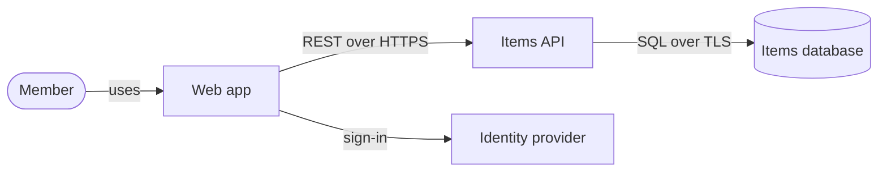
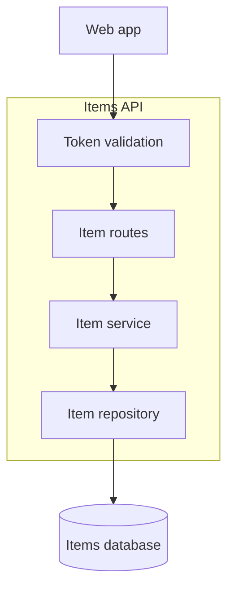
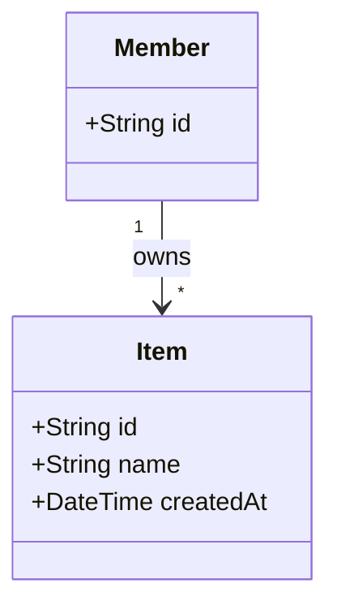

# {{title}}: architecture

A starter example for the member's list of items in `spec/SPEC.md`. Replace it with your design and keep the headings: `proofkin spec check design` checks them.

## Context

Members use the web app in their browser. It calls the Items API, which keeps items in the Items database. Members sign in with the identity provider.

## Components

| Component | Responsibility |
| --- | --- |
| Web app | The screens of the prototype; calls the API with the member's token |
| Token validation | Checks every request's token and gives the member id to the routes |
| Item routes | The REST operations of `spec/openapi.json` |
| Item service | The rules: a name is required, at most 200 characters; newest first |
| Item repository | Reads and writes items, always filtered by their owner |

## Domain model

## Deployment

- The API runs as two stateless instances behind a load balancer, in one region.
- The database is a managed relational database with point-in-time restore for 7 days.
- The web app is static files on the content delivery network.

## Quality attributes

| Attribute | Target | How |
| --- | --- | --- |
| Security | Only the owner reads or changes an item | The owner comes from the token, in every query |
| Privacy | Item names never leave the service or reach the logs | No request bodies in logs |
| Performance | The list loads in under 300 ms at the 95th percentile | An index on owner and creation time; pages of 50 |
| Availability | 99.9% of requests succeed | Two instances; a managed database |
| Accessibility | WCAG 2.2 AA | Semantic HTML; tested with the keyboard alone |

## Decisions

- ADR-0001: cursor-based paging for item lists.
