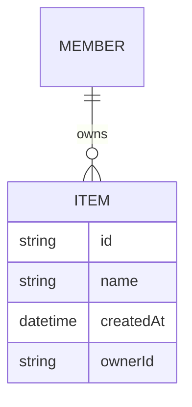

# {{title}}: data dictionary

Every field the feature stores or exchanges, the API's included. Classification: Public, Internal, Confidential, Personal or Sensitive. Personal and sensitive data need a purpose and a retention.

| Entity | Field | Type | Required | Classification | Purpose | Retention | Description |
| --- | --- | --- | --- | --- | --- | --- | --- |
| NewItem | name | string, 1–200 characters | Yes | Personal | Show the member their item | Until the member deletes it | What the member wants to keep track of; may contain personal details |
| Item | id | string (uuid) | Yes | Internal | - | As long as the item | Random id, never sequential |
| Item | name | string, 1–200 characters | Yes | Personal | Show the member their item | Until the member deletes it | As the member entered it |
| Item | createdAt | string (date-time) | Yes | Internal | - | As long as the item | When it was added; orders the list |
| Item | ownerId | string (uuid) | Yes | Personal | Show members only their own items | Until the member's account is deleted | The member who owns it, from the token; not returned by the API |
| ItemPage | items | array of Item | Yes | Personal | Show the member their list | Not stored (response only) | Up to 50 items, newest first |
| ItemPage | next | string or null | No | Internal | - | Not stored | Cursor for the next page |
| Error | error | object (code, message) | Yes | Public | - | Not stored | What went wrong; never repeats the item name |

## Domain model

