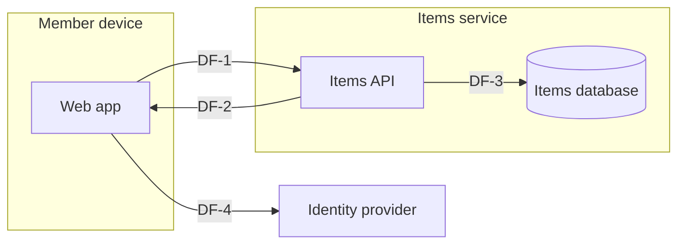

# {{title}}: data flows

Where the data goes, and how it is protected where it crosses a trust boundary (each boundary is a subgraph).

| ID | From | To | Data | Boundary | Protection |
| --- | --- | --- | --- | --- | --- |
| DF-1 | Web app | Items API | NewItem (name), bearer token | Yes | HTTPS (TLS 1.2+), token checked on every call |
| DF-2 | Items API | Web app | ItemPage of Item, the caller's only | Yes | HTTPS (TLS 1.2+); results filtered by the token's member |
| DF-3 | Items API | Items database | Item rows (name, ownerId) | No | Private network and TLS; encrypted at rest |
| DF-4 | Web app | Identity provider | Sign-in (OpenID Connect) | Yes | HTTPS; no item data |
